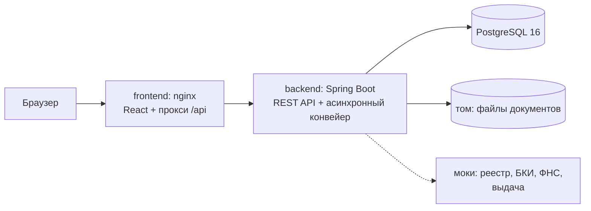

# Умный кредитный кабинет предпринимателя

**Команда «Пока без названия»**, хакатон «Альфа Будущее»

Презентация решения: [`docs/presentation.pdf`](docs/presentation.pdf)

| Участник | Почта | Telegram |
|---|---|---|
| Бондаренко Григорий Александрович | [grisha.bondarenko76@gmail.com](mailto:grisha.bondarenko76@gmail.com) | [@Bondarenko_Gregory](https://t.me/Bondarenko_Gregory) |
| Чиликин Александр Александрович | [alchula789@gmail.com](mailto:alchula789@gmail.com) | [@alexchilikin](https://t.me/alexchilikin) |
| Шкодин Роман Владимирович | [romanshkodin.ru@gmail.com](mailto:romanshkodin.ru@gmail.com) | [@UnknownData7](https://t.me/UnknownData7) |

## Содержание

- [О решении](#о-решении)
- [Исследование](#исследование)
- [Продуктовые решения](#продуктовые-решения)
- [Как проходит заявка](#как-проходит-заявка)
- [Архитектура](#архитектура)
- [Запуск](#запуск)
- [Демо-учётки](#демо-учётки)
- [Сценарий проверки](#сценарий-проверки)
- [Тесты](#тесты)
- [Переменные окружения](#переменные-окружения)
- [Документация](#документация)
- [Ограничения](#ограничения)
- [Структура репозитория](#структура-репозитория)

## О решении

Прототип цифрового кредитного конвейера для малого и микробизнеса. В одном продукте соединены путь клиента от потребности в деньгах до зачисления кредита и обработка заявки банком: проверка полноты, данные внешних источников, скоринг, кредитное решение и ручная проверка андеррайтером.

**Клиент** получает подбор продукта с объяснением, помощника для тех, кто не знает, какую сумму и срок выбрать, заявку без повторного ввода данных, понятный статус со следующим шагом, предложение с платежом и переплатой в рублях, подписание одной кнопкой и деньги на счёте.

**Банк** получает автоматические решения для простых заявок, очередь задач с приоритетами и сроком обработки, карточку заявки со всеми сведениями на одном экране, запрос данных у клиента внутри заявки, пересчёт и встречное предложение.

Все данные синтетические. Внешние системы (реестр компаний, бюро кредитных историй, налоговая служба, выдача) заменены локальными моками. Почта, SMS и звонки в сценарии не участвуют, весь путь проходит внутри продукта.

## Исследование

Опрошены четыре предпринимателя с разным опытом (продавец маркетплейса, ИП в торговле, салон красоты, начинающий ИП с кофейней) и восемь андеррайтеров из разных банков в анонимной анкете. Функции прототипа выводились из их ответов:

| Что услышали | Что сделали |
|---|---|
| 4 из 4: до заявки хотят видеть платёж и переплату в рублях | подбор со ставкой «от» и объяснением, предложение с платежом и переплатой, помощник сравнивает три срока |
| начинающий предприниматель не знает, сколько и на какой срок брать: «банк предлагает мне принять решение, к которому я пока не готов» | сценарный помощник: вопрос о задаче, варианты срока, подстановка в форму |
| 3 из 4: статус «На рассмотрении» ничего не говорит | статус-трекер и блок «Что дальше» со сроком и явным «от вас ничего не требуется» |
| 3 из 4: не хотят заново вводить то, что банк уже знает | данные компании, оборот и платежи по кредитам берутся из данных банка |
| 4 из 4: после отказа нужен следующий шаг, а не голое «Отказано» | вместо внутренних причин клиент видит, что можно сделать дальше |
| андеррайтеры: время уходит на поиск сведений в разных источниках и на неполные пакеты документов | карточка заявки собирает всё на одном экране, проверка полноты срабатывает до очереди |

Подробно: методология и ограничения выборки [`docs/research/README.md`](docs/research/README.md), портреты [`PERSONAS.md`](docs/research/PERSONAS.md), выводы по клиентам [`CLIENT_FINDINGS.md`](docs/research/CLIENT_FINDINGS.md) и андеррайтерам [`UNDERWRITER_FINDINGS.md`](docs/research/UNDERWRITER_FINDINGS.md), связь выводов с функциями и метриками [`RESEARCH_TO_PRODUCT.md`](docs/research/RESEARCH_TO_PRODUCT.md), исходные ответы в [`docs/research/sources/`](docs/research/sources/)

## Продуктовые решения

- **Границы MVP.** Сквозной путь от подбора до выдачи и ручная проверка вошли целиком. Антифрод, юридические полномочия сотрудников, распознавание документов и обслуживание кредита после выдачи сознательно оставлены за рамками (MoSCoW в [`PRODUCT_DECISIONS.md`](docs/PRODUCT_DECISIONS.md)).
- **Клиент не видит внутреннюю оценку.** Баллы, грейд и причины решения доступны только андеррайтеру. Клиент видит условия, что изменилось и что делать дальше: респонденты сами говорят, что не ждут раскрытия внутренних критериев, им нужен понятный следующий шаг.
- **Правила вместо ML.** Скоринг и кредитная логика построены на прозрачных правилах, каждое решение можно объяснить и проверить. Правила, пороги и цена описаны в [`CREDIT_RULES.md`](docs/CREDIT_RULES.md).
- **Помощник без нейросети.** Сценарный помощник закрывает задачу неуверенного клиента, языковая модель отложена по оценке RICE ([`AI_ASSISTANT_CONCEPT.md`](docs/AI_ASSISTANT_CONCEPT.md)).
- **Приоритеты.** Карта пользовательских историй, RICE для функций MVP и доработок, ICE для правок интерфейса: [`research/PRIORITIZATION.md`](docs/research/PRIORITIZATION.md). Первые доработки после хакатона: другой подходящий продукт в следующем шаге после отказа, суды и исполнительные производства в проверках, предодобренный лимит ([`PRODUCTION_ROADMAP.md`](docs/PRODUCTION_ROADMAP.md)).
- **Метрики.** Главная: доля заявок, дошедших до выдачи, и время от отправки до денег на счёте. Дерево метрик и запросы к базе прототипа: [`METRICS.md`](docs/METRICS.md).

## Как проходит заявка

1. **Потребность.** Клиент описывает задачу, сумму и срок, при неуверенности ему помогает помощник.
2. **Подбор.** Система показывает подходящие продукты с объяснением и ориентировочной ставкой, лучший отмечен.
3. **Заявка.** Данные компании уже заполнены, клиент указывает условия, прикладывает документы и даёт согласия.
4. **Проверка.** Конвейер проверяет полноту, запрашивает реестр, бюро и налоговую службу, считает скоринг.
5. **Решение.** Автоматическое одобрение, встречное предложение с меньшей суммой, отказ или задача андеррайтеру. Андеррайтер заполняет проверки и одобряет, меняет условия, запрашивает данные или отказывает.
6. **Подписание.** Клиент принимает предложение и подписывает договор кнопкой после согласия с условиями.
7. **Выдача.** Деньги зачисляются на расчётный счёт, операция появляется в истории и ленте.

Каждый переход статуса проверяется машиной состояний и пишется в историю заявки, журнал аудита и ленту клиента.

Подробно: процесс по участникам [`BUSINESS_PROCESS.md`](docs/BUSINESS_PROCESS.md), статусы и переходы [`STATE_MACHINE.md`](docs/STATE_MACHINE.md), диаграммы процесса и состояний [`DIAGRAMS.md`](docs/DIAGRAMS.md), правила скоринга, решения и очереди [`CREDIT_RULES.md`](docs/CREDIT_RULES.md)

## Архитектура

Модульный монолит на Spring Boot, PostgreSQL и веб-интерфейс на React за nginx. Один интерфейс для двух ролей: клиент (предприниматель) и андеррайтер банка.



| Сервис | Назначение | Образ |
|---|---|---|
| `frontend` | статика React, прокси `/api`, Swagger и health к backend | `nginx:1.28.0-alpine` |
| `backend` | REST API, конвейер, скоринг, очередь задач | `eclipse-temurin:21.0.8_9-jre-alpine` |
| `db` | данные заявок, история, аудит | `postgres:16.10-alpine` |

Безопасность: вход по JWT с ролями, защита от подбора пароля, проверка содержимого загружаемых файлов, заголовки безопасности и CSP в nginx, секреты только в `.env`. Наблюдаемость: health, метрики Prometheus на служебном порту, журналы в формате ECS. Подробно: [`ARCHITECTURE.md`](docs/ARCHITECTURE.md)

## Запуск

Нужны Docker Engine 24+ с Docker Compose v2 (или Docker Desktop), около 2 ГБ свободной памяти и свободные порты 3000 и 8081 (меняются в `.env`).

```bash
cp .env.example .env
docker compose up --build
```

На Windows можно запустить `start-demo.bat`: он создаст `.env` из образца, поднимет стенд, дождётся готовности и проверит сценарий S1 через API, логи сложит в папку `logs`.

Первая сборка занимает несколько минут: скачиваются зависимости Maven и npm. При первом старте создаётся схема и засеваются синтетические данные. Готовность: `docker compose ps` показывает у всех сервисов статус `healthy`.

| Адрес | Что там |
|---|---|
| http://localhost:3000 | веб-интерфейс |
| http://localhost:3000/swagger-ui/index.html | Swagger UI |
| http://localhost:3000/actuator/health | состояние backend |
| http://localhost:8081 | backend напрямую, для Postman и отладки |

Остановка: `docker compose down`, полный сброс вместе с данными: `docker compose down -v`. Вернуть демо-данные к исходному состоянию без перезапуска: `curl -X POST http://localhost:3000/api/dev/reset-demo`

## Демо-учётки

Пароль у всех `Demo#2026`, на экране входа логины подставляются кликом. Все компании, люди, ИНН и счета вымышлены.

| Логин | Компания | Сценарий |
|---|---|---|
| `romashka` | ООО «Ромашка Логистик» | S1: автоодобрение и путь до выдачи |
| `sokolov` | ИП Соколов Д. А. | S2: автоматическое встречное предложение |
| `sever-stroy` | ООО «Север-Строй» | S3: ручная проверка с залогом |
| `kim` | ИП Ким А. В. | S4: ручная проверка и запрос данных; помощник |
| `vector-opt` | ООО «Вектор-Опт» | S5: автоотказ |
| `zarya` | ООО «Заря» | S6: жёсткий стоп (компания ликвидируется) |
| `orlova` | ИП Орлова М. С. | S7: автоодобрение овердрафта |
| `uw1`, `uw2` | сотрудники банка | очередь задач андеррайтера |

## Сценарий проверки

Все сценарии с ожидаемыми значениями: [`docs/TEST_SCENARIOS.md`](docs/TEST_SCENARIOS.md)

### S1. Полный путь до выдачи, около 3 минут

1. Откройте http://localhost:3000 и войдите как `romashka`. Слева остаток расчётного счёта, кредиты и заявки, на главной «Мои заявки» и лента «Для вас».
2. Вкладка «Кредиты»: цель «Пополнение оборотных средств», 1 200 000 ₽, 9 месяцев, «Подобрать». Первым идёт «Оборотный экспресс» со ставкой от 18%.
3. «Оформить заявку» и пройти мастер: условия, данные, документы (подойдёт `postman/files/statement.pdf`), два согласия, «Отправить заявку».
4. Статус-трекер сам проходит «Подана», «Проверка», «Предложение».
5. Предложение: 1 200 000 ₽ на 9 месяцев под 18%, платёж 143 532 ₽, переплата 91 788 ₽.
6. «Принять и перейти к подписанию», согласие с условиями, «Подписать договор и получить деньги».
7. Статус «Кредит выдан»: остаток счёта вырос на 1 200 000 ₽, в «Истории» операция зачисления, в ленте событие о выдаче.

### Остальные сценарии

| Сценарий | Действия | Ожидается |
|---|---|---|
| S2 | `sokolov`: «Оборотный экспресс», 1 400 000 ₽ на 6 мес. | встречное предложение на 850 000 ₽ с перечнем изменений |
| S3 | `sever-stroy`: «Оборудование и развитие», 6 000 000 ₽ на 36 мес. с описанием залога, затем `uw1`: «Взять следующую задачу» | задача с приоритетом 2 и проверкой залога; без заполненных проверок решение не сохраняется; после одобрения у клиента появляется предложение |
| S4 | `kim`: «Оборотный экспресс», 800 000 ₽ на 6 мес.; `uw1` запрашивает данные, `kim` отвечает с файлом | задача возвращается к `uw1` с приоритетом 1, новый документ подсвечен; пересчёт создаёт новый запуск скоринга; «Одобрить с изменениями» даёт встречное предложение |
| S5 | `vector-opt`: 2 000 000 ₽ на 12 мес. | отказ без раскрытия внутренних причин, со следующим шагом |
| S6 | `zarya`: любая заявка | отказ, в журнале банка жёсткий стоп «компания в процессе ликвидации» |
| S7 | `orlova`: «Бизнес-овердрафт», 300 000 ₽ на 12 мес. | автоодобрение под 24%; лимит больше половины месячного оборота отклоняется с причиной |
| A1 | `kim`, «Кредиты», кнопка помощника справа внизу: «Закрыть разрыв до оплаты от клиентов», «1–3 месяца», «400 000» | помощник показывает три срока с платежом и переплатой, кнопка «Подставить 400 000 ₽ на 6 месяцев» заполняет форму подбора |

Сквозные проверки: чужая заявка недоступна (404), клиент на банковском API получает 403, повторная отправка заявки возвращает 409, подписание без согласия возвращает 422, после пяти неверных паролей вход блокируется (429), файл с подменённым расширением отклоняется, данные сохраняются после `docker compose restart`. Сбой внешнего источника: `MOCK_UNAVAILABLE_SOURCES=BUREAU` в `.env` и `docker compose up -d`, заявка уходит на ручную проверку, а не теряется.

## Тесты

```bash
# backend: юнит-тесты правил и интеграционные тесты сценариев (Testcontainers, нужен Docker)
cd backend && ./mvnw verify

# frontend
cd frontend && npm ci && npm test

# Postman-коллекция против запущенного стенда
npx newman run postman/collection.json -e postman/environment.json --working-dir .
```

CI на GitHub Actions при каждом пуше в `main` и в pull request прогоняет тесты backend и frontend, собирает образы, поднимает стенд, прогоняет Postman-коллекцию и проверяет заголовки безопасности и метрики.

## Переменные окружения

Образец со всеми значениями: [`.env.example`](.env.example)

| Переменная | Назначение | По умолчанию |
|---|---|---|
| `FRONTEND_PORT`, `BACKEND_PORT` | порты на хосте | `3000`, `8081` |
| `POSTGRES_DB`, `POSTGRES_USER` | имя базы и пользователя | `credit` |
| `POSTGRES_PASSWORD` | пароль базы | задаётся в `.env` |
| `SPRING_PROFILES_ACTIVE` | `demo` засевает демо-данные и включает сброс | `demo` |
| `JWT_SECRET` | секрет подписи токенов, не короче 32 символов | задаётся в `.env` |
| `JWT_TTL_MINUTES` | время жизни токена, минут | `60` |
| `KEY_RATE_PERCENT` | ключевая ставка Банка России для расчёта цены, % | `14.0` |
| `PIPELINE_STEP_DELAY_MS` | пауза между шагами конвейера, чтобы смена статусов была видна | `800` |
| `MOCK_LATENCY_MS` | задержка ответа внешних источников | `200` |
| `MOCK_UNAVAILABLE_SOURCES` | имитация сбоя: `REGISTRY`, `BUREAU`, `TAX` через запятую | пусто |
| `TASK_SLA_HOURS` | срок обработки задачи андеррайтером, часов | `4` |
| `LOGIN_MAX_ATTEMPTS`, `LOGIN_WINDOW_MINUTES` | попыток входа до блокировки и окно блокировки | `5`, `15` |
| `ASSISTANT_ENABLED`, `ASSISTANT_PROACTIVE`, `ASSISTANT_IDLE_SECONDS` | помощник: включён, сам предлагает помощь, порог бездействия | `true`, `true`, `20` |
| `LOG_FORMAT` | формат журналов: `ecs`, `logstash` или `gelf` | `ecs` |
| `CORS_ALLOWED_ORIGINS` | адреса интерфейса, которым разрешён API | `http://localhost:3000,…` |
| `JAVA_OPTS` | параметры памяти JVM | `-Xms128m -Xmx512m` |

## Документация

| Документ | Содержание |
|---|---|
| [`docs/presentation.pdf`](docs/presentation.pdf) | презентация решения |
| [`docs/research/`](docs/research/README.md) | исследование: методология, портреты, выводы, связь с продуктом, приоритизация |
| [`docs/PRODUCT_DECISIONS.md`](docs/PRODUCT_DECISIONS.md) | JTBD, границы MVP, что видит клиент, соответствие критериям кейса |
| [`docs/METRICS.md`](docs/METRICS.md) | дерево метрик и где их взять в прототипе |
| [`docs/BUSINESS_PROCESS.md`](docs/BUSINESS_PROCESS.md) | процесс по участникам |
| [`docs/CREDIT_RULES.md`](docs/CREDIT_RULES.md) | скоринг, кредитное решение, цена, каталог продуктов, правила очереди |
| [`docs/ARCHITECTURE.md`](docs/ARCHITECTURE.md) | модули, конвейер, безопасность, надёжность |
| [`docs/DIAGRAMS.md`](docs/DIAGRAMS.md) | диаграммы процесса, состояний и интерфейса |
| [`docs/STATE_MACHINE.md`](docs/STATE_MACHINE.md) | статусы заявки и допустимые переходы |
| [`docs/DATA_MODEL.md`](docs/DATA_MODEL.md) | ER-диаграмма и таблицы |
| [`docs/API.md`](docs/API.md), [`docs/openapi.yaml`](docs/openapi.yaml) | описание API и спецификация OpenAPI 3 |
| [`postman/`](postman/) | коллекция запросов с проверками и окружение |
| [`docs/TEST_SCENARIOS.md`](docs/TEST_SCENARIOS.md) | тестовые сценарии с ожидаемыми значениями |
| [`docs/AI_ASSISTANT_CONCEPT.md`](docs/AI_ASSISTANT_CONCEPT.md) | помощник: концепция, реализованный слой, варианты модели |
| [`docs/ASSUMPTIONS.md`](docs/ASSUMPTIONS.md) | допущения и описание моков |
| [`docs/PRODUCTION_ROADMAP.md`](docs/PRODUCTION_ROADMAP.md) | путь к промышленной версии |
| [`docs/DEV_LOG.md`](docs/DEV_LOG.md) | журнал разработки по версиям |
| [`THIRD_PARTY_NOTICES.md`](THIRD_PARTY_NOTICES.md) | сторонние компоненты, лицензии, смоделированные интеграции |

## Ограничения

- Подписание и выдача смоделированы: договор подписывается кнопкой с подтверждением условий, зачисление меняет остаток синтетического счёта.
- Скоринг на экспертных правилах, пороги не калиброваны на реальной статистике.
- Одна учётная запись на компанию, юридические полномочия сотрудников не моделируются.
- Документы не распознаются и не проверяются антивирусом.
- Программы раздела «Выгода» условные.

Полный список: [`ASSUMPTIONS.md`](docs/ASSUMPTIONS.md), путь к промышленной версии: [`PRODUCTION_ROADMAP.md`](docs/PRODUCTION_ROADMAP.md)

## Структура репозитория

```
backend/                Spring Boot 3.5, Java 21, Maven
  src/main/java/ru/hackathon/credit/
    auth/               вход, JWT, роли
    company/            профиль компании и финансовый снимок
    product/            каталог и подбор продуктов
    application/        заявка, машина состояний, конвейер
    document/           загрузка и хранение файлов
    scoring/            факторы, баллы, грейд, история запусков
    decision/           кредитная логика поверх скоринга
    pricing/            ставка и аннуитет
    integration/        интерфейсы внешних систем и их моки
    task/               очередь андеррайтера, проверки, решения
    offer/              предложение, подписание, выдача
    feed/               лента «Для вас»
    assistant/          помощник клиента: шаги разговора, база знаний, фильтры
    audit/              журнал событий
  src/main/resources/db/         миграции Flyway и демо-данные
  src/main/resources/knowledge/  база знаний помощника
frontend/               React 18, TypeScript, Vite, nginx
docs/                   документация, OpenAPI, презентация
  research/             исследование пользователей и исходные ответы
postman/                коллекция запросов
scripts/                запуск и смоук-проверка на Windows (из start-demo.bat)
```
