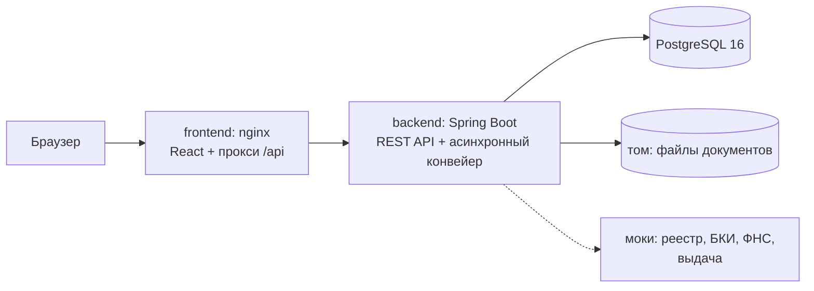

# Умный кредитный кабинет предпринимателя

Прототип цифрового кредитного конвейера для малого и микробизнеса. В одном продукте соединены клиентский путь (подбор продукта, заявка, предложение, подписание, выдача) и обработка заявки банком (проверка полноты, обогащение данными внешних источников, скоринг, кредитное решение, ручная проверка андеррайтером). Решение подготовлено для хакатона «Альфа Будущее».

Все данные синтетические, внешние системы (реестр компаний, БКИ, ФНС, выдача) заменены локальными моками. Интернет нужен только для первой сборки образов.

Решение построено от исследования пользователей: интервью и брифы четырёх предпринимателей (продавец маркетплейса, предприниматель в торговле, салон красоты, начинающий предприниматель) и анонимный опрос 8 андеррайтеров из разных банков. Портреты, выводы и их связь с функциями продукта: [`docs/research/`](docs/research/README.md).

Что получает клиент: подбор продукта с объяснением, помощник для тех, кто не знает, какую сумму и срок выбрать, заявку без повторного ввода данных, понятный статус с ориентировочным сроком, предложение с платежом и переплатой, подписание одной кнопкой и зачисление на счёт. Что получает банк: автоматические решения для простых случаев, очередь задач с приоритетами и сроками, карточку заявки со всеми сведениями на одном экране, запрос данных у клиента и встречное предложение. История изменений по версиям: [`docs/DEV_LOG.md`](docs/DEV_LOG.md).

## Содержание

- [Исследование](docs/research/README.md)
- [Архитектура](#архитектура)
- [Требования к окружению](#требования-к-окружению)
- [Запуск](#запуск)
- [Демо-учётки](#демо-учётки)
- [Сценарий проверки](#сценарий-проверки)
- [Переменные окружения](#переменные-окружения)
- [Тесты](#тесты)
- [API и документация](#api-и-документация)
- [Ограничения и допущения](#ограничения-и-допущения)
- [Что где лежит](#что-где-лежит)

## Архитектура

Модульный монолит на Spring Boot, PostgreSQL и веб-интерфейс на React за nginx. Один интерфейс для двух ролей: клиент (предприниматель) и андеррайтер банка.



После отправки заявка обрабатывается асинхронно: проверка полноты → запросы к мокам → скоринг на прозрачных правилах → кредитная логика (автоодобрение, встречное предложение, отказ или задача андеррайтеру). Статусы меняются последовательно, каждый переход проверяется машиной состояний и пишется в историю, журнал аудита и ленту клиента.

Подробно: [`docs/ARCHITECTURE.md`](docs/ARCHITECTURE.md), диаграммы процесса и состояний: [`docs/DIAGRAMS.md`](docs/DIAGRAMS.md).

| Сервис | Назначение | Образ |
|---|---|---|
| `frontend` | статика React, прокси `/api`, Swagger и health к backend | `nginx:1.28.0-alpine` |
| `backend` | REST API, конвейер, скоринг, очередь задач | `eclipse-temurin:21.0.8_9-jre-alpine` |
| `db` | данные заявок, история, аудит | `postgres:16.10-alpine` |

## Требования к окружению

- Docker Engine 24+ с Docker Compose v2 (или Docker Desktop)
- около 2 ГБ свободной памяти: лимиты контейнеров в сумме 1,4 ГБ
- свободные порты 3000 и 8081 (меняются в `.env`)
- для запуска тестов без Docker: JDK 21, Maven 3.9, Node 22

## Запуск

```bash
cp .env.example .env
docker compose up --build
```

На Windows можно запустить `start-demo.bat`: он создаст `.env` из образца, поднимет стенд, дождётся готовности и проверит сценарий S1 через API, логи сложит в папку `logs`.

Первая сборка занимает несколько минут: скачиваются зависимости Maven и npm. При первом старте профиль `demo` создаёт схему и засевает синтетические данные.

| Адрес | Что там |
|---|---|
| http://localhost:3000 | веб-интерфейс |
| http://localhost:3000/swagger-ui/index.html | Swagger UI |
| http://localhost:3000/actuator/health | состояние backend |
| http://localhost:8081 | backend напрямую (для Postman и отладки) |

Метрики Prometheus (`/actuator/prometheus`) и подробный health отдаются на служебном порту 8090 только внутри сети стенда: снаружи через nginx доступен лишь `/actuator/health`. Посмотреть метрики: `docker compose exec backend wget -qO- http://localhost:8090/actuator/prometheus | grep credit_`.

Проверка: `docker compose ps` показывает у всех сервисов статус `healthy`.

Остановка: `docker compose down`. Полный сброс вместе с данными: `docker compose down -v`.

**Сброс демо-данных без перезапуска** (вернуть базу к исходному состоянию перед повторным показом):

```bash
curl -X POST http://localhost:3000/api/dev/reset-demo
```

## Демо-учётки

Пароль у всех: `Demo#2026`. На экране входа логины можно подставить кликом.

| Логин | Компания | Сценарий |
|---|---|---|
| `romashka` | ООО «Ромашка Логистик» | S1: автоодобрение и путь до выдачи |
| `sokolov` | ИП Соколов Д. А. | S2: автоматическое встречное предложение |
| `sever-stroy` | ООО «Север-Строй» | S3: ручная проверка с залогом |
| `kim` | ИП Ким А. В. | S4: ручная проверка и запрос данных |
| `vector-opt` | ООО «Вектор-Опт» | S5: автоотказ |
| `zarya` | ООО «Заря» | S6: жёсткий стоп (компания ликвидируется) |
| `orlova` | ИП Орлова М. С. | S7: автоодобрение овердрафта |
| `uw1`, `uw2` | сотрудники банка | очередь задач андеррайтера |

Все компании, люди, ИНН и счета вымышлены.

## Сценарий проверки

Полное описание всех сценариев с ожидаемыми значениями: [`docs/TEST_SCENARIOS.md`](docs/TEST_SCENARIOS.md).

### S1. Полный путь до выдачи (около 3 минут)

1. Откройте http://localhost:3000 и войдите как `romashka`.
2. Слева колонка «Мои продукты»: остаток расчётного счёта, действующие кредиты и заявки в работе. На главной баннеры, «Мои заявки» и лента «Для вас» с датой и временем каждой карточки. «Прочитано» убирает карточку.
3. Откройте вкладку «Кредиты» (или баннер «Подобрать кредит»). Цель «Пополнение оборотных средств», 1 200 000 ₽, 9 месяцев, «Подобрать». Первым идёт «Оборотный экспресс» с объяснением и ставкой от 18%.
4. «Оформить заявку». Мастер: Условия → Данные (платежи по кредитам можно не менять) → Документы (приложите любой PDF, например `postman/files/statement.pdf`) → Проверка и отправка, поставьте два согласия, «Отправить заявку».
5. На странице заявки статус-трекер сам проходит «Подана» → «Проверка» → «Предложение» (обновление каждые 3 секунды, пауза между шагами 0,8 с).
6. В карточке предложения: 1 200 000 ₽, 9 месяцев, 18% годовых, платёж 143 532 ₽, переплата 91 788 ₽. Баллов, грейда и причин решения клиент не видит: это внутренняя оценка банка, она доступна только андеррайтеру.
7. «Принять и перейти к подписанию» → отметьте согласие с условиями → «Подписать договор и получить деньги».
8. Статус «Кредит выдан», экран с суммой и счётом. Остаток счёта слева вырос на 1 200 000 ₽, во вкладке «История» появилась операция зачисления, в ленте событие «Кредит выдан».

Настройки (шестерёнка справа вверху): светлая, тёмная или системная тема и скрытие остатков; глаз рядом скрывает суммы на счетах одним нажатием. Вкладка «Выгода»: приглашение партнёров со ссылкой и предложения для бизнеса (условные).

### Короткие проверки остальных сценариев

| Сценарий | Действия | Ожидается |
|---|---|---|
| S2 | `sokolov`: «Оборотный экспресс», 1 400 000 ₽ на 6 мес. | встречное предложение на 850 000 ₽ и что изменилось относительно заявки (у андеррайтера в базе грейд B) |
| S3 | `sever-stroy`: «Оборудование и развитие», 6 000 000 ₽ на 36 мес., описание залога. Затем `uw1`: «Взять следующую задачу» | задача с приоритетом 2 и проверкой «Проверка залога»; без заполненных проверок решение не сохраняется; после «ОК» и «Одобрить» у клиента без перезагрузки появляется предложение |
| S4 | `kim`: «Оборотный экспресс», 800 000 ₽ на 6 мес. `uw1` берёт задачу, ставит проверке «Нужны данные», решение «Запросить данные». `kim` отвечает и прикладывает файл | задача возвращается к `uw1` с приоритетом 1 и пометкой «повторная», новый документ подсвечен; пересчёт с подтверждённым оборотом создаёт новый запуск скоринга; «Одобрить с изменениями» даёт клиенту встречное предложение |
| S5 | `vector-opt`: 2 000 000 ₽ на 12 мес. | отказ без раскрытия причин, предложение подать новую заявку позже (внутри банка грейд D) |
| S6 | `zarya`: любая заявка | отказ; клиенту причина не раскрывается, в журнале банка жёсткий стоп «компания в процессе ликвидации» |
| S7 | `orlova`: «Бизнес-овердрафт», 300 000 ₽ на 12 мес. | автоодобрение, ставка 24%; лимит больше половины месячного оборота (500 000 ₽) отклоняется с понятной причиной |

Помощник (сценарий A1 в [`docs/TEST_SCENARIOS.md`](docs/TEST_SCENARIOS.md)): `kim`, «Кредиты», кнопка помощника справа внизу → «Закрыть разрыв до оплаты от клиентов» → «1–3 месяца» → «400 000» → «Подставить 400 000 ₽ на 6 месяцев». Помощник работает без языковой модели: цифры из подбора и калькулятора, ответы из базы знаний.

Сквозные проверки: чужая заявка по прямому адресу недоступна (404), клиент на банковском эндпоинте получает 403, повторная отправка заявки возвращает 409, подписание без согласия с условиями возвращает 422, после пяти неверных паролей за 15 минут вход блокируется (429), файл с подменённым расширением отклоняется, после `docker compose restart` данные на месте.

Проверка отказа внешнего источника: задайте в `.env` `MOCK_UNAVAILABLE_SOURCES=BUREAU`, выполните `docker compose up -d` и подайте заявку под любым клиентом. Заявка не теряется, а уходит на ручную проверку с причиной «не получены данные: бюро кредитных историй».

## Переменные окружения

| Переменная | Назначение | По умолчанию |
|---|---|---|
| `FRONTEND_PORT` | порт веб-интерфейса на хосте | `3000` |
| `BACKEND_PORT` | порт backend на хосте | `8081` |
| `POSTGRES_DB`, `POSTGRES_USER` | имя базы и пользователя | `credit` |
| `POSTGRES_PASSWORD` | пароль базы | задаётся в `.env` |
| `SPRING_PROFILES_ACTIVE` | `demo` засевает демо-данные и включает сброс | `demo` |
| `JWT_SECRET` | секрет подписи токенов, не короче 32 символов | задаётся в `.env` |
| `JWT_TTL_MINUTES` | время жизни токена | `60` |
| `KEY_RATE_PERCENT` | ключевая ставка Банка России для расчёта цены, %: 14,00 по решению от 23.10.2026 | `14.0` |
| `PIPELINE_STEP_DELAY_MS` | пауза между шагами конвейера, чтобы смена статусов была видна | `800` |
| `MOCK_LATENCY_MS` | имитация задержки ответа внешних источников | `200` |
| `MOCK_UNAVAILABLE_SOURCES` | имитация сбоя источников: `REGISTRY`, `BUREAU`, `TAX` через запятую | пусто |
| `TASK_SLA_HOURS` | срок обработки задачи андеррайтером | `4` |
| `LOGIN_MAX_ATTEMPTS` | неудачных попыток входа до блокировки на пару «логин и адрес» | `5` |
| `LOGIN_WINDOW_MINUTES` | окно подсчёта попыток и длительность блокировки, минут | `15` |
| `LOG_FORMAT` | формат журналов backend: `ecs` (JSON для сборщиков логов) или `logstash`, `gelf` | `ecs` |
| `CORS_ALLOWED_ORIGINS` | адреса интерфейса, которым разрешены запросы к API | `http://localhost:3000,…` |
| `JAVA_OPTS` | параметры памяти JVM | `-Xms128m -Xmx512m` |
| `ASSISTANT_ENABLED` | показывать помощника клиенту | `true` |
| `ASSISTANT_PROACTIVE` | помощник сам предлагает помощь по признакам затруднения | `true` |
| `ASSISTANT_IDLE_SECONDS` | бездействие на форме подбора до предложения помощи, секунд | `20` |

## Тесты

```bash
# backend: юнит-тесты правил и интеграционные тесты сценариев S1–S6, ролей, ленты и защиты входа
# (интеграционные поднимают PostgreSQL через Testcontainers, нужен Docker)
cd backend && ./mvnw verify

# frontend: статус-трекер, форма заявки, предложение и подписание, лента, скрытие остатков, тема, помощник
cd frontend && npm ci && npm test

# Postman-коллекция против запущенного стенда (сбрасывает демо-данные перед прогоном)
npx newman run postman/collection.json -e postman/environment.json --working-dir .
```

Те же проверки запускает CI на GitHub Actions (`.github/workflows/ci.yml`) при каждом пуше: тесты backend и frontend, затем сборка образов, `docker compose up`, прогон Postman-коллекции, проверка заголовков безопасности и метрик. Dependabot еженедельно предлагает обновления Maven, npm, Docker-образов и действий CI.

## API и документация

| Документ | Содержание |
|---|---|
| [`docs/API.md`](docs/API.md) | группы эндпоинтов, ошибки, примеры |
| [`docs/openapi.yaml`](docs/openapi.yaml) | спецификация OpenAPI 3 |
| [`postman/`](postman/) | коллекция запросов с проверками и окружение |
| [`docs/STATE_MACHINE.md`](docs/STATE_MACHINE.md) | статусы и допустимые переходы |
| [`docs/DATA_MODEL.md`](docs/DATA_MODEL.md) | ER-диаграмма и таблицы |
| [`docs/BUSINESS_PROCESS.md`](docs/BUSINESS_PROCESS.md) | процесс по участникам |
| [`docs/CREDIT_RULES.md`](docs/CREDIT_RULES.md) | скоринг, кредитное решение, цена, каталог продуктов, правила очереди андеррайтера |
| [`docs/research/`](docs/research/README.md) | исследование: методология, портреты, выводы по клиентам и андеррайтерам, связь выводов с продуктом |
| [`docs/PRODUCT_DECISIONS.md`](docs/PRODUCT_DECISIONS.md) | границы MVP, связь потребностей и функций, что видит клиент |
| [`docs/ASSUMPTIONS.md`](docs/ASSUMPTIONS.md) | допущения, описание моков |
| [`docs/METRICS.md`](docs/METRICS.md) | дерево метрик продукта и где их взять в прототипе |
| [`docs/PRODUCTION_ROADMAP.md`](docs/PRODUCTION_ROADMAP.md) | путь к промышленной версии и доработки по исследованию |
| [`docs/AI_ASSISTANT_CONCEPT.md`](docs/AI_ASSISTANT_CONCEPT.md) | помощник по подбору и оформлению кредита: концепция, реализованный сценарный слой, варианты модели |

Обновить `docs/openapi.yaml` из запущенного приложения:

```bash
curl -s http://localhost:8081/v3/api-docs.yaml -o docs/openapi.yaml
```

## Ограничения и допущения

- Подписание и выдача смоделированы: договор подписывается кнопкой с подтверждением условий, зачисление меняет остаток синтетического счёта.
- Программы раздела «Выгода» условные, выплаты и подключения не выполняются.
- Скоринг на экспертных правилах из [`docs/CREDIT_RULES.md`](docs/CREDIT_RULES.md), пороги не калиброваны на реальной статистике.
- Одна учётная запись на компанию, юридические полномочия сотрудников не моделируются.
- Документы не распознаются и не проверяются антивирусом.
- Обработка заявок идёт в пуле потоков приложения; после перезапуска незавершённые заявки дообрабатываются автоматически.

Полный список: [`docs/ASSUMPTIONS.md`](docs/ASSUMPTIONS.md), [`docs/PRODUCTION_ROADMAP.md`](docs/PRODUCTION_ROADMAP.md).

## Что где лежит

```
backend/                Spring Boot 3.5, Java 21, Maven
  src/main/java/ru/hackathon/credit/
    auth/               вход, JWT, роли
    company/            профиль компании и финансовый снимок
    product/            каталог и подбор продуктов
    application/        заявка, машина состояний, конвейер
    document/           загрузка и хранение файлов
    scoring/            факторы, баллы, грейд, история запусков
    decision/           кредитная логика поверх скоринга
    pricing/            ставка и аннуитет
    integration/        интерфейсы внешних систем и их моки
    task/               очередь андеррайтера, проверки, решения
    offer/              предложение, подписание, выдача
    feed/               лента «Для вас»
    assistant/          помощник клиента: шаги разговора, база знаний, фильтры
    audit/              журнал событий
  src/main/resources/db/  миграции Flyway и демо-данные
  src/main/resources/knowledge/  база знаний помощника (Markdown)
frontend/               React 18, TypeScript, Vite, nginx
docs/                   документация и OpenAPI
  research/             исследование пользователей и исходные ответы
postman/                коллекция запросов
scripts/                запуск и смоук-проверка стенда на Windows (вызывается из start-demo.bat)
```

## Данные

Все данные синтетические. Реальных компаний, людей, ИНН, счетов и банковских данных в проекте нет.
