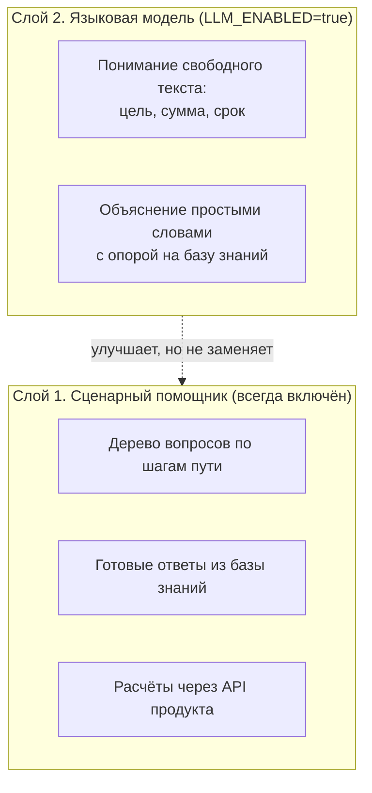
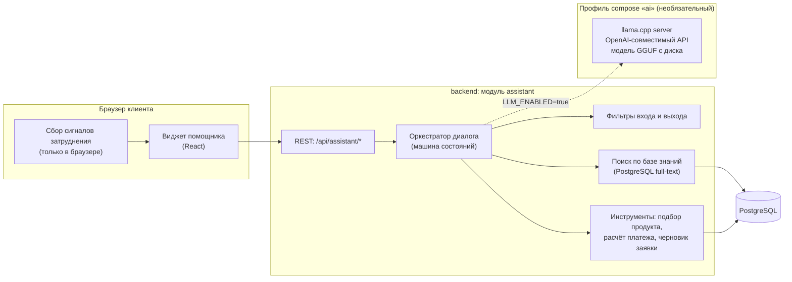
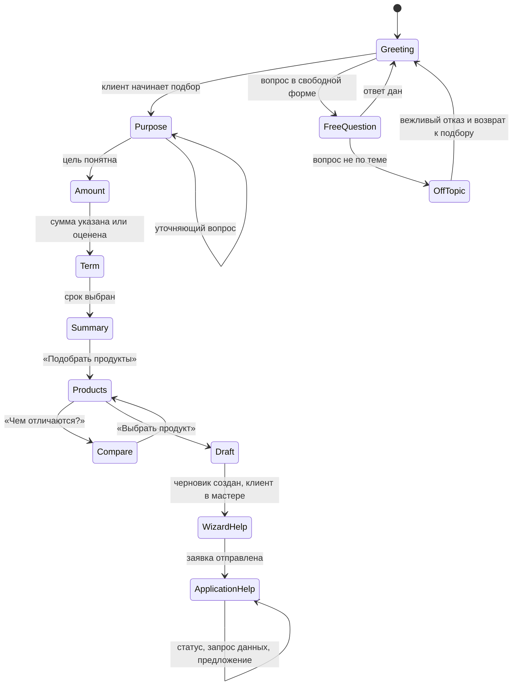
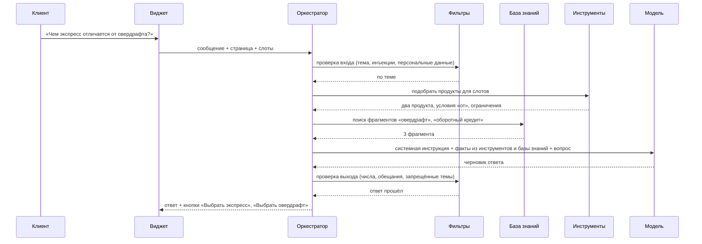

# Помощник по подбору и оформлению кредита: концепция

> Статус: этапы 0–2 плана (раздел 14) реализованы: база знаний, сценарный помощник, проактивность. Модель (этап 3) не подключена. Решения и упрощения реализации перенесены в `ARCHITECTURE.md`, `ASSUMPTIONS.md` и `DIAGRAMS.md`, ход работ в `DEV_LOG.md`.

## 1. Задача

Текущий путь клиента рассчитан на предпринимателя, который заранее знает цель, сумму и срок: вкладка «Кредиты», три поля, подбор продуктов, мастер заявки. Целевая аудитория кейса включает молодой и микробизнес, где такой уверенности часто нет. Типичные затруднения:

- клиент не может сформулировать цель в терминах банка («нужно закрыть аренду, пока не пришли деньги от заказчика» вместо «кассовый разрыв»);
- не понимает, какой срок выбрать и как он влияет на платёж и переплату;
- не может оценить нужную сумму;
- видит два подходящих продукта и не понимает разницы между ними;
- не понимает, что происходит с заявкой и что от него требуется на следующем шаге.

Исследование подтвердило эти затруднения (вывод К2 в [`research/CLIENT_FINDINGS.md`](research/CLIENT_FINDINGS.md)). Начинающий предприниматель описывает ситуацию так: «банк предлагает мне принять решение, к которому я пока не готов» и просит помощника, который «ведёт меня по шагам», задаёт по одному вопросу, показывает несколько вариантов срока с платежом и переплатой и не подталкивает к кредиту. Эти требования легли в сценарии помощника: вопрос о том, когда вернутся деньги, вместо выбора срока, таблица из трёх сроков, кнопки вместо анкеты, строка «Помощник подсказывает, но не принимает решения».

Без подсказки часть таких клиентов закрывает страницу. Помощник нужен не как демонстрация ИИ, а как инструмент, который удерживает неуверенного клиента на пути от потребности до подписания договора. Бизнес-цель измерима: доля клиентов, дошедших от раздела «Кредиты» до отправленной заявки, и доля брошенных черновиков.

Помощник **не принимает решений** за клиента и банк: не обещает одобрения, не называет ставку раньше расчёта системы, не отправляет заявку и не подписывает договор. Он объясняет, задаёт вопросы, подставляет значения в форму и показывает, где нажать.

## 2. Ограничения кейса, которые определяют решение

| Ограничение | Источник | Что это значит для помощника |
|---|---|---|
| LLM и ML не обязательны и не дают преимущества, в основном пути их нет | бриф, раздел 1, п. 9 | основная ценность помощника должна работать **без модели**; модель только улучшает качество ответов |
| Вызов LLM только через OpenAI-совместимый API (`LLM_BASE_URL`, `LLM_API_KEY`, `LLM_MODEL`), по умолчанию выключен (`LLM_ENABLED=false`), не на критическом пути | бриф, раздел 12 | при выключенной или недоступной модели помощник продолжает работать в сценарном режиме |
| Только модели с открытыми весами, источник указан в документации | бриф, раздел 12; `CLAUDE.md` | веса скачиваются заранее и лежат локально, лицензия фиксируется в `THIRD_PARTY_NOTICES.md` |
| Запуск в Docker на обычном ПК без GPU: около 8 ГБ ОЗУ у клиента, около 12 ГБ на сервере | бриф, раздел 1, п. 2 | только малые модели в квантизации для CPU, лимит памяти контейнера |
| Без платных API и без интернета во время работы | бриф, раздел 1, п. 3 | никаких облачных моделей, всё локально |
| Сценарий целиком внутри продукта | бриф, раздел 1, п. 6 | помощник не предлагает позвонить, написать в мессенджер или на почту |
| Клиент не видит результатов внутренней оценки | решение команды, `ASSUMPTIONS.md` | помощник не имеет доступа к баллам, грейду и причинам решения и не может их раскрыть |

Отдельно: раздел 12 брифа описывает ИИ-блок как «пояснение решения». Причины решения клиенту не раскрываются, поэтому помощник заменяет этот блок другим назначением: навигацией и консультацией до решения. Это отклонение от брифа нужно записать в `ASSUMPTIONS.md` при реализации.

## 3. Ключевое решение: два слоя



**Слой 1, сценарный.** Детерминированный диалог с кнопками-ответами: «На что нужны деньги?» → варианты в бытовых формулировках → уточняющие вопросы → подстановка значений в форму. Ответы на типовые вопросы берутся из базы знаний по ключевым словам. Слой работает всегда, не требует модели, его поведение полностью предсказуемо и тестируется обычными тестами. Этого достаточно для показа жюри и для критерия «UX для людей без банковской экспертизы».

**Слой 2, модель.** Включается переменной окружения. Делает две вещи, которые сценарию недоступны: понимает свободный текст («у меня кофейня, хочу вторую точку, денег не хватает на ремонт и кофемашину») и переформулирует сравнение продуктов и ответы базы знаний под ситуацию клиента. Модель **не считает** суммы и платежи, не выбирает продукт и не управляет переходами: цифры и решения приходят только из API продукта.

Почему не «чистый» чат-бот на модели: малые модели на CPU ошибаются в числах, выдумывают условия и нестабильно вызывают функции. В кредитном продукте одна выдуманная ставка обходится дороже, чем вся польза от свободного диалога. Двухслойная схема даёт гарантированный минимум и безопасное улучшение.

## 4. Где помощник появляется в пути клиента

| Шаг | Экран | Что делает помощник | Действия в интерфейсе |
|---|---|---|---|
| 1. Потребность | «Кредиты», поля цели, суммы, срока | выясняет задачу бытовыми вопросами и переводит её в цель банка; помогает оценить сумму («сколько стоит оборудование, есть ли своя часть»); объясняет, как срок влияет на платёж и переплату, показывает 2–3 варианта срока с расчётом | «Подставить в форму», «Подобрать продукты» |
| 2. Выбор продукта | карточки рекомендаций | объясняет разницу подходящих продуктов человеческим языком, применительно к задаче клиента; объясняет, почему продукт недоступен и что можно изменить | «Выбрать этот продукт», «Сравнить подробнее» |
| 3. Мастер заявки | шаги «Условия», «Данные», «Документы», «Проверка» | объясняет термины (платёж по другим кредитам, залог, согласие на запрос в бюро), подсказывает, какой документ подойдёт и где его взять | «Перейти к шагу», «Что такое залог» |
| 4. Ожидание решения | страница заявки | говорит, что происходит и сколько ждать, без внутренних деталей оценки | нет |
| 5. Запрос данных | «Нужны данные» | помогает понять запрос банка и что приложить | «Открыть форму ответа» |
| 6. Предложение | карточка предложения | объясняет платёж, переплату, разницу между встречным предложением и заявкой, помогает решить: принять или подать новую заявку на других условиях | «Принять», «Подать новую заявку» |
| 7. Подписание | блок подписания | объясняет, что подписывается и когда придут деньги | нет, подписывает только клиент |
| После отказа | страница заявки | говорит, что можно сделать (другая сумма, срок, продукт, позже), без раскрытия причин | «Подать новую заявку» |

Пример диалога на шаге 1 (сценарный слой, без модели):

```text
Помощник:  Помогу подобрать кредит. Для чего нужны деньги?
           [Закупить товар] [Закрыть разрыв до оплаты от клиентов]
           [Купить оборудование или транспорт] [Открыть новое направление] [Не знаю, расскажу сам]
Клиент:    Закрыть разрыв до оплаты от клиентов
Помощник:  Через сколько обычно приходят деньги от клиентов?
           [До месяца] [1–3 месяца] [Дольше]
Клиент:    1–3 месяца
Помощник:  Сколько не хватает, чтобы закрыть расходы до поступления денег? Можно примерно.
Клиент:    400 000
Помощник:  Для такой задачи обычно берут короткий кредит или овердрафт. Предлагаю 400 000 ₽ на 6 месяцев:
           платёж около 70 400 ₽ в месяц при ставке от 19%. Если взять на 3 месяца, платёж выше, но переплата меньше.
           [Подставить 400 000 ₽ на 6 месяцев] [Сравнить 3 и 6 месяцев] [Изменить сумму]
```

Цифры в ответе получены из расчёта API, а не сгенерированы. Формулировки ответов хранятся в базе знаний и шаблонах.

## 5. Интерфейс

### 5.1. Состояния виджета

```text
  Свёрнут                    Подсказка                         Открыт (десктоп, ~380×560)
                                                               ┌───────────────────────────────┐
                                                               │ Помощник               ─  ✕   │
                             ┌──────────────────────────┐      ├───────────────────────────────┤
                             │ Не знаете, какой срок     │      │ Помогу подобрать кредит.      │
                             │ выбрать? Подскажу.        │      │ Для чего нужны деньги?        │
                             │ [Помочь]  [Не сейчас]     │      │ [Закупить товар] [Разрыв]     │
                             └────────────┬─────────────┘      │ [Оборудование] [Не знаю]      │
          ┌────┐                     ┌────┐                    │                               │
          │ ?  │                     │ ?  │                    ├───────────────────────────────┤
          └────┘                     └────┘                    │ Напишите вопрос…          ➤   │
  круглая кнопка в правом     пузырь над кнопкой,              └───────────────────────────────┘
  нижнем углу, 56 px          не перекрывает форму              на телефоне: на весь экран снизу
```

- Кнопка в правом нижнем углу, на всех страницах клиента, кроме входа. Подпись при наведении: «Помощник».
- Панель открывается справа поверх контента, не сдвигает страницу и не забирает фокус у поля, где клиент печатает.
- Сверху панели всегда видна строка «Помощник подсказывает, но не принимает решения. Условия кредита определяет банк».
- Кнопки быстрых ответов и кнопки действий («Подставить в форму») важнее поля ввода: неуверенному клиенту проще нажать, чем сформулировать.
- Помощник подсвечивает поле или карточку, о которой говорит, и прокручивает к ней страницу.
- История разговора сохраняется на время сессии и при переходе между страницами.
- В настройках кабинета: «Предлагать помощь автоматически» (вкл/выкл).

### 5.2. Когда помощник предлагает помощь сам

Предложение «появиться через 10 секунд бездействия» понятно, но в чистом виде даст ложные срабатывания: клиент может читать карточку продукта или отойти от компьютера. Предлагается срабатывать по признакам затруднения и показывать сначала **пузырь**, а не открывать панель целиком.

| Сигнал | Где | Порог (настраивается) |
|---|---|---|
| Нет ввода и прокрутки на пустой форме | «Кредиты» | 20 с |
| Цель меняется несколько раз | «Кредиты» | 3 смены за минуту |
| Сумма или срок меняются туда-обратно | «Кредиты» | 4 изменения без отправки |
| Переходы между карточками рекомендаций без выбора | подбор продуктов | 30 с или 2 раскрытия |
| Шаг мастера открыт долго без изменений | мастер заявки | 45 с |
| Ошибка валидации повторяется | мастер заявки | 2 раза подряд на одном поле |
| Попытка уйти со страницы с незаполненным черновиком | мастер заявки | один раз |

Правила показа:

- не больше одного автоматического предложения на страницу и трёх за сессию;
- после «Не сейчас» на этой странице больше не предлагать;
- не показывать, пока клиент печатает или в фокусе поле ввода;
- текст пузыря зависит от сигнала: «Не знаете, какой срок выбрать?», «Подсказать, чем отличаются продукты?»;
- вкладка браузера неактивна: таймер стоит;
- все пороги вынесены в конфигурацию, чтобы подобрать их по метрикам (раздел 12), а не на глаз.

Помимо плавающей кнопки стоит добавить **встроенные входы** прямо в форму: ссылки «Не знаю цель», «Как выбрать срок?» рядом с полями и «Чем они отличаются?» над карточками рекомендаций. Они заметнее плашки в углу и открывают помощника сразу на нужном вопросе.

## 6. Архитектура



**Модуль `assistant` в backend** (тот же модульный монолит, отдельный пакет):

- `AssistantController`: `POST /api/assistant/sessions`, `POST /api/assistant/sessions/{id}/messages`, `POST /api/assistant/sessions/{id}/actions`; ответ потоком (SSE) для режима с моделью;
- `DialogOrchestrator`: машина состояний разговора (раздел 7), хранит заполненные слоты: цель, сумма, срок, наличие залога, выбранный продукт;
- `AssistantTools`: обёртки над существующими сервисами, без новых бизнес-правил:
  - подбор продуктов: `ProductMatcher` (как `POST /api/products/recommend`);
  - ориентировочный платёж: `PricingCalculator` по ставке «от» продукта, с пометкой «ориентировочно»;
  - сравнение вариантов срока: тот же калькулятор для 2–3 сроков;
  - создание или обновление черновика: `ApplicationService.createDraft` / `updateDraft` (только по нажатию клиента);
  - статус и следующий шаг заявки: `ApplicationViews.nextStep` (те же данные, что видит клиент);
- `KnowledgeBase`: поиск фрагментов базы знаний;
- `Guardrails`: проверки до и после модели (раздел 10);
- `LlmClient`: вызов OpenAI-совместимого `/v1/chat/completions` с таймаутом 15 с и выключателем при ошибках.

**Сервис модели** запускается отдельным профилем: `docker compose --profile ai up`. Без профиля стенд работает как сейчас. Веса модели скачиваются один раз скриптом `scripts/download-model` в том `models/` и не попадают в репозиторий; в образ попадает только сервер.

**Почему llama.cpp server**, а не Ollama или vLLM: vLLM рассчитан на GPU; Ollama удобна, но добавляет свой формат хранения и автозагрузку моделей из интернета; llama.cpp server (MIT) читает файл GGUF с диска, отдаёт OpenAI-совместимый API и хорошо работает на CPU. Ollama остаётся запасным вариантом, у неё тоже есть OpenAI-совместимый API.

## 7. Машина состояний диалога



Состояние определяет, какие кнопки показать и какие инструменты доступны. В свободном тексте модель (если включена) только **извлекает слоты** в JSON по схеме: `{"purpose": "CASH_GAP", "amount": 400000, "termMonths": null, "confidence": 0.8}`. Переход по состояниям делает оркестратор. При низкой уверенности или выключенной модели помощник задаёт уточняющий вопрос с кнопками.

Один шаг диалога с моделью:



Если модель выключена, не ответила за 15 с или ответ не прошёл проверку, клиент получает готовый ответ из базы знаний для этого вопроса и кнопки следующего шага.

## 8. База знаний

Помощник «знает продукт» за счёт базы знаний, а не за счёт памяти модели. Это главный механизм против выдуманных ответов.

| Раздел | Содержание | Источник |
|---|---|---|
| Продукты | назначение, для кого, суммы, сроки, нужен ли залог, как рассматривается | таблица `product` (генерируется автоматически, всегда актуально) |
| Цели | бытовые формулировки и соответствие целям банка: «закупка к сезону» → закупка товара | файл `knowledge/purposes.md` |
| Сравнения | попарные отличия продуктов простым языком, когда что выбрать | `knowledge/compare/*.md` |
| Термины | платёж, переплата, аннуитет, залог, овердрафт, кредитная история, ставка «от» | `knowledge/glossary.md` |
| Процесс | шаги заявки, сроки, что будет после отправки, документы и где их взять | `knowledge/process.md` |
| Частые вопросы | «можно ли досрочно», «что если не одобрят», «зачем согласие на бюро» | `knowledge/faq.md` |
| Чего помощник не делает | список тем для отказа и формулировки отказов | `knowledge/policy.md` |

Формат: Markdown-файлы в репозитории, разбитые на фрагменты по заголовкам (200–500 слов). При старте backend индексирует их в таблицу `kb_chunk` с полем `tsvector` (русская морфология PostgreSQL, без дополнительных моделей). У каждого фрагмента есть версия и дата; ответ помощника хранит идентификаторы использованных фрагментов для разбора качества.

Векторный поиск (эмбеддинги) на объёме в несколько десятков страниц не нужен: полнотекстового поиска PostgreSQL достаточно. Если база вырастет, можно добавить `pgvector` и малую модель эмбеддингов (например, `multilingual-e5-small`, MIT, около 120 млн параметров), это отдельное решение.

## 9. Модель: варианты

Ориентиры памяти и скорости даны для квантизации Q4_K_M на 4–8 ядрах CPU без GPU и требуют замера на целевом ноутбуке. Сейчас стенд занимает около 1,4 ГБ лимитов памяти.

| Вариант | Параметры | Файл Q4, ОЗУ в работе | Скорость на CPU, ориентир | Русский язык | Лицензия | Оценка |
|---|---|---|---|---|---|---|
| Без модели (только слой 1) | | 0 | мгновенно | шаблоны | | обязательная основа |
| Qwen3-1.7B | 1,7 млрд | ~1,1 ГБ, ~2 ГБ | 15–25 токенов/с | удовлетворительно, нужны факты из базы знаний | Apache 2.0 | запасной вариант для ноутбука 8 ГБ |
| **Qwen3-4B-Instruct-2507** | 4 млрд | ~2,5 ГБ, ~3,5 ГБ | 7–12 токенов/с | хорошо | Apache 2.0 | **рекомендуемый по умолчанию** |
| T-lite-it-2.1 (на базе Qwen3-8B, дообучен на русском) | 8 млрд | ~5 ГБ, ~6 ГБ | 3–6 токенов/с | очень хорошо | Apache 2.0 | лучший русский, только для сервера 12 ГБ, ответы медленные |
| GigaChat3-10B-A1.8B (MoE, 1,8 млрд активных) | 10 млрд | ~6 ГБ, ~7 ГБ | быстрее 8B за счёт MoE, нужна проверка сборок GGUF | очень хорошо | MIT | интересен для сервера; GGUF пока сторонние, нужна проверка |
| Gemma 3 4B, Llama 3.2 3B | 3–4 млрд | ~2,5 ГБ | 8–12 токенов/с | средне | собственные лицензии Google и Meta с ограничениями | не рекомендуется из-за условий лицензий |

Рекомендация: **Qwen3-4B-Instruct-2507 в Q4_K_M** как основной вариант и Qwen3-1.7B как облегчённый, переключаются переменной `LLM_MODEL`. Ответы короткие (до 120 слов), поэтому даже при 7–10 токенах в секунду ответ печатается за 5–10 секунд потоком, первые слова появляются через 1–2 секунды. Лимит памяти контейнера модели: 4 ГБ.

Источники весов и лицензий указываются в `THIRD_PARTY_NOTICES.md` с точным названием репозитория на Hugging Face и контрольной суммой файла.

## 10. Удержание в теме и безопасность

Тематику удерживает не обучение модели, а несколько уровней проверки. Каждый уровень работает и без модели.

1. **Фильтр входа.** Правила и словари определяют тему: кредиты, продукты, заявка, документы, термины. Вопрос вне темы («напиши стих», «какой курс доллара», «что думаешь о конкурентах») получает вежливый отказ и возврат к подбору. Если включена модель, она дополнительно классифицирует тему одним коротким запросом с ответом «да/нет».
2. **Системная инструкция.** Роль, тон, запреты, требование отвечать только по переданным фактам, длина ответа, формат JSON для извлечения слотов.
3. **Факты только из инструментов.** Модель получает продукты, условия и расчёты в виде данных. Любое число в ответе должно совпадать с числом из инструментов, иначе ответ отклоняется.
4. **Фильтр выхода.** Запрещены: обещания одобрения («вам точно одобрят»), упоминание баллов, грейда, скоринга и причин решения, условия, которых нет в каталоге, советы по обходу проверок банка, призывы связаться вне продукта.
5. **Инъекции в запросе.** Текст клиента передаётся модели только как данные в отдельном блоке; фразы вида «забудь инструкции» отсекаются фильтром входа; у модели нет инструментов, меняющих данные: создать черновик можно только кнопкой, которую нажимает клиент.
6. **Разделение данных.** Инструменты вызываются от имени текущего пользователя с его токеном и видят только его компанию. Данные внутренней оценки банка в модуль `assistant` не передаются вообще, поэтому раскрыть их нельзя даже при ошибке модели.
7. **Персональные данные.** В журнал разговоров не пишутся номера документов и счетов (маскирование по шаблонам). Разговоры хранятся 30 дней для разбора качества.
8. **Ограничение частоты.** Не больше 20 сообщений в минуту на пользователя, длина сообщения до 1000 символов.

Шаблон отказа: «Я помогаю только с подбором и оформлением кредита для бизнеса. Могу подсказать, какой продукт подойдёт под вашу задачу или как выбрать срок».

## 11. Нужно ли дообучение

| Уровень | Что даёт | Затраты | Рекомендация |
|---|---|---|---|
| Системная инструкция + база знаний + инструменты | знание продукта, точные цифры, удержание в теме | 0, только тексты | обязательно |
| Примеры диалогов в инструкции (5–10 штук) | стабильный тон и формат ответа | минимальные | обязательно |
| Ограничение формата вывода (JSON-схема или грамматика llama.cpp) | надёжное извлечение слотов малой моделью | минимальные | обязательно |
| Дообучение LoRA на 500–1000 синтетических диалогах | короче и точнее ответы, лучше понимание бытовых формулировок | нужен GPU на несколько часов вне стенда, разметка и проверка диалогов, повторная квантизация | после пилота, если метрики качества ниже цели |

Если команда пойдёт на дообучение: диалоги генерируются по сценариям из раздела 4 и проверяются вручную; обучение LoRA (например, библиотеками `peft` или `unsloth`) на исходной модели; слияние адаптера и конвертация в GGUF; публикуются и веса, и описание набора данных. Набор данных синтетический, без реальных клиентов. Для хакатона дообучение не требуется: качество в узкой теме обеспечивают база знаний и фильтры.

## 12. Метрики и оценка качества

**Продуктовые метрики** (события виджета пишутся в существующий журнал аудита без текста сообщений):

- доля клиентов, дошедших от раздела «Кредиты» до отправки заявки, с помощником и без;
- доля брошенных черновиков;
- время от входа в «Кредиты» до отправки заявки;
- доля принятых автоматических предложений помощи и доля «Не сейчас»;
- доля диалогов, закончившихся действием («Подставить в форму», «Выбрать продукт»).

**Качество ответов** проверяется набором из 100–150 эталонных вопросов (по темам из раздела 8 и 30 вопросов вне темы) с ожидаемыми фактами. Критерии: ответ по теме, числа совпадают с расчётом, нет запрещённых формулировок, вне темы всегда отказ. Набор прогоняется в CI для сценарного слоя и вручную при смене модели.

## 13. Настройки

| Переменная | Назначение | По умолчанию |
|---|---|---|
| `ASSISTANT_ENABLED` | показывать помощника | `true` |
| `ASSISTANT_PROACTIVE` | предлагать помощь автоматически | `true` |
| `ASSISTANT_IDLE_SECONDS` | порог бездействия на форме подбора | `20` |
| `LLM_ENABLED` | использовать модель (слой 2) | `false` |
| `LLM_BASE_URL` | адрес OpenAI-совместимого сервера | `http://llm:8080/v1` |
| `LLM_API_KEY` | ключ, если сервер его требует | пусто |
| `LLM_MODEL` | имя модели на сервере | `qwen3-4b-instruct-2507-q4_k_m` |
| `LLM_TIMEOUT_SECONDS` | таймаут ответа модели | `15` |

## 14. План внедрения

| Этап | Содержание | Оценка | Что показать жюри |
|---|---|---|---|
| 0. База знаний | тексты: цели, сравнения продуктов, термины, процесс, частые вопросы, отказы | 1 день | |
| 1. Сценарный помощник | виджет, состояния, кнопки, подстановка в форму, встроенные входы «Не знаю цель», «Как выбрать срок», «Чем отличаются», поиск по базе знаний, тесты сценариев | 2–3 дня | полный путь неуверенного клиента без модели |
| 2. Проактивность | сигналы затруднения, пузырь, правила показа, настройка в кабинете, события в журнал | 1 день | помощник сам предлагает помощь на форме подбора |
| 3. Модель | профиль compose `ai`, llama.cpp server, скрипт загрузки весов, `LlmClient`, извлечение слотов, переформулирование, фильтры выхода, поток ответа | 2–3 дня | свободный вопрос «у меня кофейня…» превращается в заполненную форму |
| 4. Оценка | эталонный набор вопросов, прогон, подбор порогов | 1 день | таблица качества в документации |
| 5. Дообучение (по результатам) | синтетические диалоги, LoRA, GGUF | вне хакатона | |

Этапы 0–2 дают законченную функцию без нарушения требований брифа и без новых зависимостей. Этап 3 добавляется только если на него остаётся время и после замера скорости на ноутбуке проверки.

## 15. Риски и вопросы для команды

- **Скорость на ноутбуке жюри.** При 8 ГБ ОЗУ модель 4B вместе со стендом может не поместиться или работать медленно. Решение: модель только в профиле `ai`, облегчённая модель как запасной вариант, сценарный слой всегда работает.
- **Навязчивость.** Автоматическое появление может раздражать. Решение: пузырь вместо панели, лимиты показа, выключатель в настройках.
- **Ответственность за совет.** Помощник может восприниматься как консультант, который гарантирует результат. Решение: постоянная строка «не принимает решений», запрет обещаний в фильтре выхода, действия только по кнопке клиента.
- **Расхождение с брифом.** ИИ-блок в брифе описан как пояснение решения. Нужно согласовать, что помощник по подбору заменяет его, и записать в `ASSUMPTIONS.md`.
- **Объём текстов.** Качество помощника определяется базой знаний. Кто пишет тексты и кто их вычитывает?
- **Вопросы на решение:** какие пороги проактивности берём для показа; включаем ли этап 3 в демо или показываем только сценарный слой; нужен ли помощник в рабочем месте андеррайтера (например, поиск по регламенту проверок) или только у клиента.

## Источники

- Требования к ИИ-блоку и ограничения стенда: `docs/PROJECT_BRIEF.md`, разделы 1 и 12.
- Qwen3, малые модели и лицензия Apache 2.0: [документация Xinference по Qwen3](https://inference.readthedocs.io/en/latest/models/builtin/llm/qwen3.html), [каталог Qwen на Hugging Face](https://endpoints.huggingface.co/catalog/collection/qwen).
- T-lite-it-2.1 на базе Qwen3-8B, Apache 2.0: [карточка квантизованной версии с метаданными исходной модели](https://huggingface.co/pimenovdv/T-lite-it-2.1-AWQ-4bits).
- GigaChat 3 Lightning (10B, 1,8B активных, MIT): [статья на Хабре](https://habr.com/ru/articles/985976/), [сторонняя сборка GGUF](https://www.promptlayer.com/models/gigachat3-1-10b-a1-8b-750-v1-gguf).
