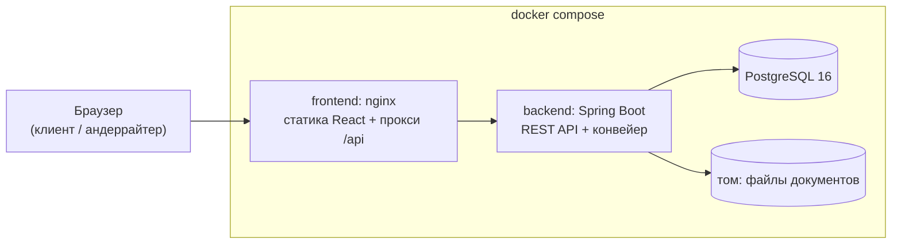
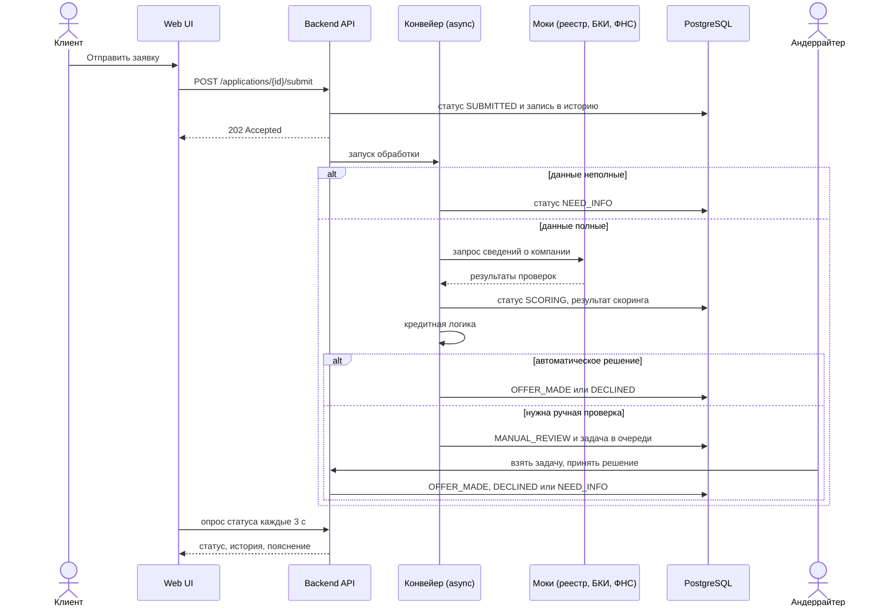

# Архитектура

> Статус: проектное описание. После реализации сверить с кодом (пакеты, конфиги, порты) и поправить расхождения.

## 1. Назначение и контекст

Прототип цифрового кредитного конвейера для малого и микробизнеса. Он соединяет в одном продукте клиентский путь (потребность, заявка, предложение, подписание, выдача) и внутреннюю обработку заявки банком (проверки, скоринг, решение, ручная проверка андеррайтером).

Внешние системы (реестры, БКИ, ФНС, подписание, выдача) замещены локальными моками за интерфейсами, данные синтетические. Подробности — `ASSUMPTIONS.md`.

## 2. Общая схема

Диаграммы бизнес-процесса, структуры и состояний лежат в `DIAGRAMS.md`. Краткая схема развёртывания:

Единая точка входа для пользователя — порт frontend. Swagger UI и health-эндпоинты backend доступны на его порту (адреса — в README).

## 3. Модульный монолит

Один деплой, чёткие границы пакетов. Контроллер вызывает сервис, сервис — репозиторий. Модули общаются через сервисы и события, а не через чужие репозитории.

| Модуль | Ответственность |
|---|---|
| `auth` | вход, JWT, роли `CLIENT` и `UNDERWRITER`, проверка прав на сервере |
| `company` | профиль компании и синтетический финансовый снимок «по данным банка» |
| `product` | каталог продуктов, подбор под потребность с объяснением |
| `application` | заявка, машина состояний, история статусов, запросы информации |
| `document` | загрузка и выдача документов, ограничения на файлы |
| `scoring` | факторы, баллы, грейд, жёсткие стопы, история запусков |
| `decision` | кредитная логика поверх скоринга: авто-одобрение, отказ, встречное предложение, ручная проверка |
| `pricing` | ставка (ключевая + спред + премия за риск), аннуитетный платёж |
| `integration.mock` | адаптеры внешних систем за интерфейсами, детерминированные mock-реализации |
| `task` | очередь задач андеррайтера, приоритеты, SLA, проверки по задаче |
| `offer` | предложения условий, принятие, подписание кодом, симуляция выдачи |
| `feed` | лента новостей и подсказок с таргетингом |
| `audit` | журнал событий и история переходов |
| `common` | ошибки (RFC 7807), конфигурация, утилиты |

## 4. Ключевой поток: подача и обработка заявки

Обработка после `submit` идёт асинхронно в отдельном пуле потоков. Между шагами есть настраиваемая пауза (`PIPELINE_STEP_DELAY_MS`), чтобы смену статусов было видно на демо.

## 5. Архитектурные решения и компромиссы

| Решение | Почему | Цена |
|---|---|---|
| Модульный монолит, а не микросервисы | проще запустить и проверить на обычном ПК, меньше ресурсов, границы модулей сохранены | масштабируется целиком, не по модулям |
| Скоринг на правилах, а не ML | прозрачность, объяснимость, детерминированность, нет зависимости от данных и моделей | нет статистической силы ML-модели |
| Скоринг и кредитное решение — разные модули | одна и та же оценка риска даёт разные условия по продуктам и суммам | чуть больше кода |
| Асинхронный конвейер | реалистично для банка, статус-трекер «живой» | нужна защита от гонок (версия заявки, проверка статуса) |
| Очередь задач в PostgreSQL | без брокера, транзакционность, `SELECT ... FOR UPDATE SKIP LOCKED` для безопасной выдачи задач | при росте нагрузки заменяется на брокер (см. `PRODUCTION_ROADMAP.md`) |
| Моки за интерфейсами | замена на реальные интеграции без изменения бизнес-логики | поведение реальных сервисов упрощено |
| Один веб-интерфейс с двумя ролями | достаточно для сквозного сценария, меньше дублирования | в промышленной версии интерфейсы банка и клиента разделяют |

## 6. Безопасность

- Пароли хешируются BCrypt, доступ по JWT с коротким временем жизни, секрет из окружения.
- Права проверяются на сервере: клиент видит только свои заявки, банковские эндпоинты доступны только роли `UNDERWRITER`.
- Валидация входных данных, ограничения на загрузку файлов (размер, тип, безопасные имена, хранение вне веб-корня), единый формат ошибок.
- Секреты не хранятся в репозитории (`.env.example` без реальных значений), в логи не попадают пароли и токены.

## 7. Надёжность и сопровождение

- Flyway-миграции, транзакции вокруг каждого перехода статуса, оптимистическая блокировка заявки.
- Защита от повторных действий: любой переход проверяет текущий статус, недопустимый переход возвращает `409`.
- Таймауты и обработка ошибок у внешних адаптеров: при сбое источника заявка не теряется, а уходит на ручную проверку с причиной.
- Структурированные логи с идентификатором корреляции, Actuator health и readiness, healthcheck в docker compose.
- Журнал бизнес-событий в таблицах `status_history` и `audit_event`.

## 8. Масштабирование

API не хранит состояние: можно запускать несколько экземпляров за балансировщиком. Состояние лежит в PostgreSQL, файлы — в общем хранилище. Раздача задач безопасна при конкуренции за счёт блокировок на уровне БД. Дальнейший рост — в `PRODUCTION_ROADMAP.md`.
