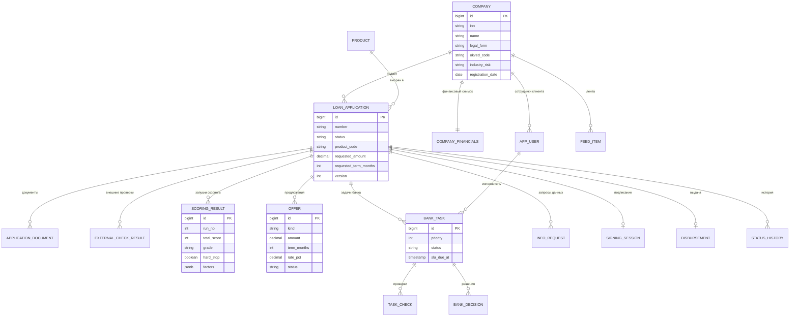

# Модель данных

> Статус: сверено с миграцией `backend/src/main/resources/db/migration/V1__schema.sql`. Демо-данные: `db/demo/V100__demo_data.sql` (только профиль `demo`).

Каждое поле нужно кредитному процессу: либо участвует в скоринге и решении, либо нужно для сопровождения заявки, либо для аудита.

## ER-диаграмма

Показаны ключевые атрибуты. Полный состав — в миграциях.

## Описание таблиц

| Таблица | Назначение | Ключевые поля |
|---|---|---|
| `app_user` | пользователи и роли | login, password_hash, role, company_id |
| `company` | профиль компании-клиента | inn, legal_form (`IP`/`OOO`), okved_code, industry_risk, registration_date, employees_count, tax_system, account_masked, months_with_bank |
| `company_financials` | синтетический снимок «по данным банка» | annual_turnover_12m, avg_monthly_turnover, turnover_growth_pct, existing_monthly_obligations |
| `product` | каталог продуктов | code, purposes (коды целей через запятую), spread_pct, min/max сумма и срок, requires_collateral, routing, auto_limit_amount, min_avg_monthly_turnover |
| `loan_application` | заявка | number, product_code, purpose, requested_amount, requested_term_months, monthly_obligations_declared, collateral_description, согласия, status, decision_reason_code, decision_summary, current_offer_id, parent_application_id (новая заявка после отказа), version |
| `application_document` | документы заявки | doc_type, file_name, storage_path, is_new_for_bank |
| `external_check_result` | ответы моков (реестр, БКИ, ФНС) | source, payload (JSONB), status |
| `scoring_result` | запуски скоринга | run_no, total_score, grade, hard_stop, hard_stop_reason, payment_load, factors (JSONB), inputs_snapshot (JSONB), trigger (`INITIAL`/`RECALC`), created_by |
| `offer` | предложения условий | kind (`INITIAL`/`COUNTER`), amount, term_months, rate_pct, monthly_payment, status, explanation |
| `bank_task` | задача андеррайтера | priority 1–10, status, assignee_user_id, sla_due_at, reason_codes, is_repeat, version; частичный уникальный индекс не даёт одному андеррайтеру держать две задачи `IN_PROGRESS` |
| `task_check` | проверки по задаче | check_code, title, goal, status (`PENDING`/`OK`/`NEGATIVE`/`NEEDS_INFO`), comment |
| `bank_decision` | решение андеррайтера | result, comment, counter_offer |
| `info_request` | запрос данных у клиента | source (`SYSTEM`/`BANK`), task_id, text, status, client_answer |
| `signing_session` | подписание кодом | code_hash (SHA-256, сам код не хранится), attempts_left, status (`ACTIVE`/`CONFIRMED`/`BLOCKED`/`REPLACED`) |
| `disbursement` | симуляция выдачи | amount, account_masked, simulated = true |
| `status_history` / `audit_event` | история переходов и событий | from_status, to_status, actor_type, actor_id, comment |
| `feed_item` | элементы ленты клиента | type, title, body, reason, related_application_id, is_read |
| `news_catalog` | каталог новостей и подсказок с таргетингом | type, title, body, target_legal_form, target_industry_risk, target_product_code, target_status, weight (пустое поле таргетинга значит «подходит всем») |

## Принципы

- Решение по заявке воспроизводимо: в `scoring_result` хранится снимок входных данных и разбор по факторам, история запусков не удаляется.
- Любое изменение статуса фиксируется в `status_history` с автором и комментарием.
- Деньги хранятся как `decimal`, а не как число с плавающей точкой.
- Документы лежат в файловом хранилище (том Docker), в БД — только метаданные и путь.
