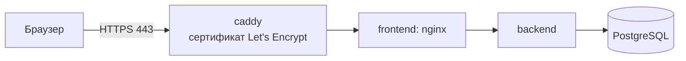

# Развёртывание на сервере

Кейс рекомендует опубликовать решение на бесплатном внешнем сервере, чтобы эксперты могли работать с прототипом без локального запуска. Для проверки решение по-прежнему запускается локально одной командой (README), серверный вариант добавляет к тому же `docker-compose.yml` только HTTPS.

## Что получится



- Адрес вида `https://203-0-113-10.sslip.io`: сервис sslip.io бесплатно превращает IP сервера в доменное имя, Caddy выпускает на него сертификат. Свой домен тоже подходит.
- Снаружи открыты только порты 80 и 443. Порты frontend и backend привязаны к `127.0.0.1`.
- Пароль базы и секрет JWT генерируются при установке, `.env` доступен только root.
- Сброс демо-данных снаружи закрыт, он выполняется на самом сервере.

## Требования к серверу

- Ubuntu 22.04 или 24.04, 2 vCPU, 4 ГБ RAM, 20 ГБ диска.
- Публичный IP, входящие порты 22, 80 и 443 открыты в группе безопасности облака.

Подходит, например, бесплатная виртуальная машина Cloud.ru Evolution (2 vCPU, 4 ГБ RAM, 30 ГБ) или стартовый грант Yandex Cloud. Условия бесплатных тарифов меняются, их нужно сверить при регистрации.

## Установка

Подключиться к серверу по SSH под root (или выполнить `sudo -i`) и запустить:

```bash
curl -fsSL https://raw.githubusercontent.com/UnknownData7/alfa-hack-2026/main/deploy/install.sh | bash
```

Со своим доменом, у которого A-запись указывает на сервер:

```bash
curl -fsSL https://raw.githubusercontent.com/UnknownData7/alfa-hack-2026/main/deploy/install.sh | SITE_DOMAIN=demo.example.ru bash
```

Скрипт ставит Docker, клонирует репозиторий в `/opt/credit-cabinet`, создаёт `.env` и запускает стенд. Первая сборка занимает 5–10 минут. В конце скрипт печатает адрес стенда. Если Docker Hub с сервера недоступен, скрипт подключает зеркало `mirror.gcr.io`.

Демо-учётки и сценарий проверки те же, что в README.

## Сопровождение

| Действие | Команда на сервере |
|---|---|
| Обновить до последней версии `main` | повторно запустить установку, `.env` и данные сохраняются |
| Сбросить демо-данные перед показом | `/opt/credit-cabinet/deploy/reset-demo.sh` |
| Состояние сервисов | `cd /opt/credit-cabinet && docker compose -f docker-compose.yml -f deploy/docker-compose.server.yml ps` |
| Логи backend | `cd /opt/credit-cabinet && docker compose logs -f backend` |
| Остановить | `cd /opt/credit-cabinet && docker compose -f docker-compose.yml -f deploy/docker-compose.server.yml down` |

Развернуть конкретную версию: `BRANCH=v1.0.0` перед `bash`, например `... | BRANCH=v1.0.0 bash`.

## Проверка

CI запускает серверный вариант на каждом пуше в `main`: Caddy поднимается с доменом `localhost` и внутренним сертификатом, проверяются health через HTTPS, отдача интерфейса и то, что сброс демо-данных снаружи возвращает 404.
