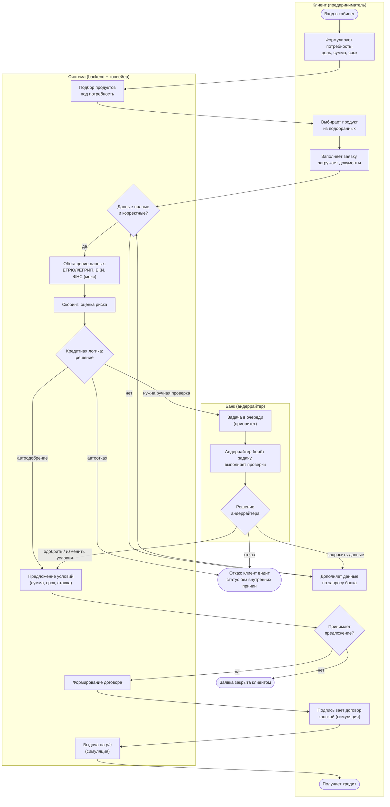
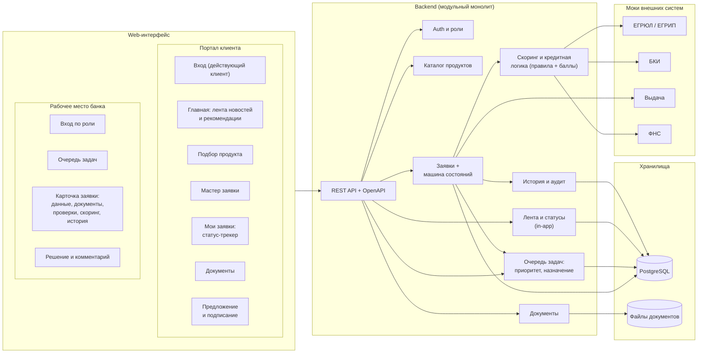
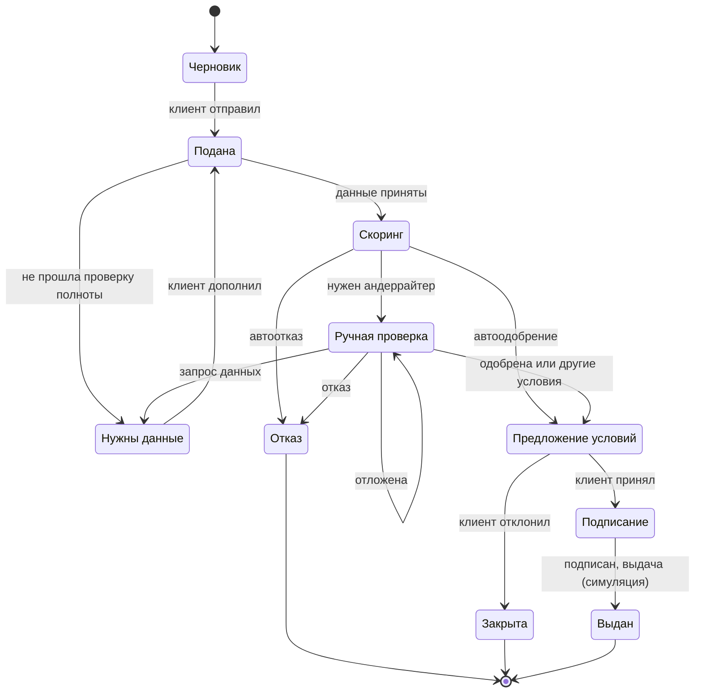
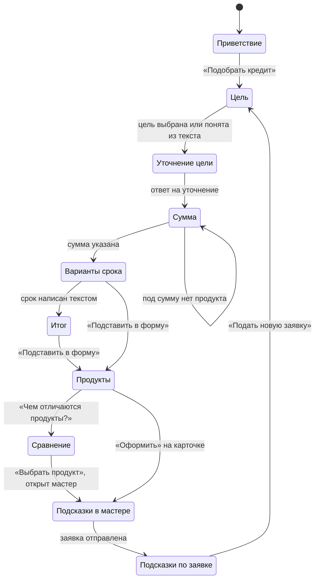

# Умный кредитный кабинет — UML-наброски

Черновик для хакатона. Диаграммы в Mermaid — GitHub рисует их прямо в README, ничего конвертировать не нужно.

## 1. Бизнес-процесс: от входа клиента до выдачи кредита

Дорожки: клиент, система (backend + конвейер), банк (андеррайтер). Подпись и выдача — симуляция, внешние источники — моки (так разрешает кейс).

## 2. Структура веб-приложения

Два веб-интерфейса (портал клиента и рабочее место банка) поверх одного backend. Все уведомления — внутри продукта: почта, SMS и мессенджеры по кейсу запрещены.

## 3. Бонус: состояния заявки

Кейс требует диаграмму состояний заявки — она напрямую следует из процесса выше.

## 4. Помощник клиента: шаги разговора

Реализация `DialogOrchestrator`. Вопрос в свободной форме и отказ по теме не меняют шаг: клиент получает ответ и кнопку возврата к тому месту, где был. Подсказки в мастере и на странице заявки открываются по странице, на которой клиент вызвал помощника.

## Что взято из идей промышленных систем и как адаптировано

| Идея | Как в MVP |
|---|---|
| Ручные проверки как очередь задач с приоритетом и кнопкой «взять задачу» | Очередь андеррайтера: сортировка по приоритету, одна задача в работе, статус «отложена» |
| Набор проверок формирует стратегия по условиям заявки | Простые правила: какие проверки назначить (доход, занятость, документы) |
| Пересчёт скоринга при правке дохода или суммы | Андеррайтер меняет данные, система пересчитывает оценку и условия |
| Скоринг отделён от кредитного решения | Две ступени: оценка риска, затем правила по продукту, сумме, сроку |
| Результат не бинарный | Одобрить, изменить условия, запросить данные, отказать, отложить |

Намеренно не вошло в MVP: антифрод-роль, эскалация на уполномоченного сотрудника, интеграции с CRM и шиной. Это можно показать как «потенциал развития».
